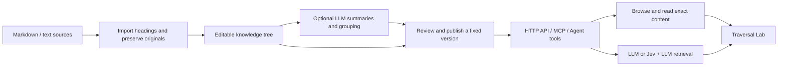

# VikingTree-AI-RAG

**English** | [繁體中文](README.zh-TW.md)

A PHP-first knowledge workspace with a separate **Traversal Lab**. Organize company documents into a browsable hierarchy, publish stable versions, and expose the same content through HTTP, MCP and agent tool schemas.

The application currently uses **Arbor** as its UI name and internal PHP namespace. The repository is named **VikingTree-AI-RAG**.


This is a working local v0.1 application, intended for the initial self-use validation. It is not a workflow execution engine: an instruction such as “If yes, go to step2” is source content. The caller interprets the condition and chooses the next API call.

## How it works

VikingTree-AI-RAG gives documents a navigable structure: **collection → category → document → section or step**. Each node can contain source content and children, plus an abstract and a longer overview. The hierarchy helps callers select an area before loading detailed evidence. Explicit references connect related steps without turning their text into executable rules.



1. **Build:** import files or create nodes manually. Source files are preserved; headings supply initial structure. LLM assistance can summarize nodes and propose document groups.
2. **Link:** explicit `step2` references within the relevant source scope resolve to stable node IDs. Missing or ambiguous targets stay unresolved and block publication.
3. **Publish:** freeze a version so later calls can keep reading the same instructions, paths and references while a separate draft changes.
4. **Discover and navigate:** external apps or agents call `list_collections`, `browse` and `read`. These operations do not need a model. Responses include exact arguments for the next read, rather than making an agent guess a path.
5. **Retrieve with AI:** when requested, the server examines candidate summaries, explores selected branches, reads bounded source evidence and can produce a cited answer. Jev is an optional scoring layer; the LLM remains required for AI features.

For example, “If yes, go to step2” remains instruction text. The caller decides whether the condition holds, then sends the returned `read_args` for step2. The server does not execute the procedure or store the caller's workflow progress.

This is a custom implementation inspired by hierarchical retrieval concepts, not an OpenViking or PageIndex wrapper. The current version does not use embeddings or a vector database and does not claim better retrieval accuracy than vector RAG. It combines deterministic browsing, lexical search and bounded model-guided tree retrieval. Hybrid search is a future direction.

## Traversal Lab


The separate Lab calls the same HTTP endpoints used by external clients. Send one command at a time, inspect readable content or raw JSON, follow exact references, and replay recorded operational events. The guided example makes six actual requests from collection discovery through reading Step 2. The map distinguishes visited nodes from the current operation; it displays hierarchy edges, not executable Yes/No rules. Screenshots show the included fictional sample data.

## Run locally

Requires PHP 8.2+ with PDO SQLite, cURL and mbstring. No Composer installation, Node build or frontend framework is needed.

```sh
git clone https://github.com/devbadrian-tech/VikingTree-AI-RAG.git
cd VikingTree-AI-RAG
php -S 127.0.0.1:8787 -t public public/index.php
```

- Workspace: <http://127.0.0.1:8787/>
- Traversal Lab: <http://127.0.0.1:8787/lab>
- API and model configuration: <http://127.0.0.1:8787/settings>

The first run creates `data/arbor.sqlite` and a clearly labelled fictional troubleshooting collection with six linked steps. The running demonstration uses this sample, not real company policy.

On macOS/Linux, `PHP_CLI_SERVER_WORKERS=4` before the command allows other requests while an AI search waits for its provider. AI builds run in a separate PHP CLI worker. The built-in server is for local development, not an internet deployment.

## Try the complete flow

1. In **Workspace**, import Markdown/text files or paste a document. Headings become nodes, and the original source file is preserved separately.
2. Select a node to inspect its abstract, content, children and exact references. Edit a node; changes autosave. Drag a canvas node to save its visual position. Drag an outline row onto another node to change its parent. The parent selector is the keyboard alternative.
3. With a model configured, **AI organize & summarize** creates bounded abstracts and overviews, optionally groups immediate documents into folders, and reviews navigation coherence. Original instruction text is not rewritten. The last review is available from the workspace footer and is marked stale after later edits.
4. Review and **Publish version**. Broken explicit references block publication. Publication creates an immutable snapshot; the draft remains editable.
5. In **Traversal Lab**, select a version and send real tool calls. **Run next example** performs six requests, one click at a time: root → troubleshooting → network → dropout → step1 → step2. That final branch choice belongs to the example caller.
6. Read the response, inspect its JSON, or replay recorded trace events. Clicking a returned reference performs the exact next read. Clicking a map node prepares a read command without sending it.

The map shows hierarchy edges, not executable Yes/No edges. Green nodes have been included in recorded operations; gold nodes belong to the current operation. Browse counts as visiting a node's metadata. **Fit** gives an overview; zoom and scrolling expose details. On small canvases, the map initially focuses the selected branch. The whole-tree control restores the complete overview.

## Consumer API

All four tools use `POST /api/tools/{name}` with JSON arguments. Definitions are available at `GET /api/tool-definitions`; the generated OpenAPI 3.1 description is at `GET /api/openapi.json`.

| Tool | Purpose | Model calls |
| --- | --- | --- |
| `list_collections` | Discover root menus | None |
| `browse` | List children; depth 1–4; paginated | None |
| `read` | Exact content, abstract or overview; up to 10 IDs | None |
| `search` | Keyword search, LLM routing, or Jev + LLM routing | Depends on mode |

### Read a specified step

```sh
curl http://127.0.0.1:8787/api/tools/read \
  -H 'Content-Type: application/json' \
  -d '{"pathway":"viking://troubleshooting/network/dropout","getNodeContent":"step1","version":"sample_v1"}'
```

The response includes the exact instruction body and references such as:

```json
{
  "label": "step2",
  "target_id": "demo_step2",
  "origin": "explicit_text",
  "status": "resolved",
  "target": {
    "title": "Step 2 · Check the incident log",
    "pathway": "viking://troubleshooting/network/dropout/step2",
    "read_args": {
      "id": "demo_step2",
      "version": "sample_v1"
    }
  }
}
```

Pass the returned `read_args` to `read`. Stable IDs survive draft moves/renames; a pinned published version preserves the exact content and paths. `latest` resolves once per call and the response returns its concrete version. Avoid `draft` for production callers: it is mutable, and its revision is exposed for inspection rather than immutable continuation.

### Browse a menu

```json
{
  "id": "demo_dropout",
  "version": "sample_v1",
  "depth": 1,
  "limit": 2
}
```

Follow `data.next_cursor` with the same node, version and depth until it is null. Each item supplies `read_args` and `browse_args`. Multi-level browse returns a flat, bounded slice with `parent_id` and `depth`; callers can reconstruct the requested subtree. The server does not attach an unbounded whole tree to every response.

### Search

```json
{
  "query": "What should I check when the connection drops?",
  "id": "demo_troubleshooting",
  "version": "sample_v1",
  "mode": "llm",
  "answer": true,
  "limit": 6
}
```

Modes: `lexical`, `llm`, `jev_llm`. Lexical search explicitly returns matches without a generated answer. AI modes explore up to three branches per level, eight levels, 60 candidates per level and ten evidence nodes. A selected node can supply content even if it also has children. Candidates and citations are validated against the selected version and scope. Jev mode filters with the configured threshold, asks the LLM to choose among multiple viable candidates, and applies a final relevance check.

`data.coverage` reports `entire_scope`, `selected_branches` or `budget_limited`. `no_answer` means no supported answer in the explored evidence, not proof that the entire company corpus lacks an answer. `budget_exhausted` is distinct from `no_answer`. Provider/configuration errors use non-2xx responses with `error.code` and never masquerade as a knowledge miss. Trace messages describe operations, not hidden model reasoning.

### Authentication

Copy `.env.example` to `.env` and set `ARBOR_API_TOKEN` to require a shared access token. External clients send `Authorization: Bearer YOUR_TOKEN`; the browser shows an unlock form. Without a configured token, the app accepts only loopback requests with a localhost host name. Browser writes require CSRF protection and cross-origin requests are rejected.

This is a single-workspace trust model. The shared token grants administrative access as well as consumer access. It is not a tenant/user/role permission system. Do not expose the local server as a business service; add a production HTTP server, TLS, scoped credentials, ACLs and operational controls first.

## MCP and agent tools

Stateless HTTP MCP endpoint: `http://127.0.0.1:8787/mcp`. Supported protocol: `2025-11-25`, JSON-RPC POST responses, `initialize`, `ping`, `tools/list`, `tools/call`, `resources/list`, and `resources/read`. Notifications return 202. GET/SSE, resumable streaming, subscriptions and OAuth discovery are not implemented.

Stdio configuration:

```json
{
  "mcpServers": {
    "arbor": {
      "command": "php",
      "args": ["/absolute/path/to/VikingTree-AI-RAG/bin/mcp.php"]
    }
  }
}
```

Stdio uses filesystem access to the same database; it does not require the HTTP token. Tool responses include both `structuredContent` and a JSON text fallback. HTTP and stdio share the same tool implementation. An agent integration can use the JSON schemas from `/api/tool-definitions` or the OpenAPI document directly.

## Model connections

Configure **API & models**. No credentials or cloud calls are preconfigured.

- **OpenAI-compatible**: base URL ending in `/v1`, API key, model ID; Chat Completions with `max_completion_tokens` and JSON requested in the prompt. Providers with different parameter contracts need an adapter adjustment.
- **Anthropic**: `https://api.anthropic.com/v1`, API key, model ID; Messages API.
- **AWS Bedrock**: model/inference-profile ID, region and access/secret/session credentials. AWS environment credentials are supported. Native SigV4 signing calls Converse. IAM roles/automatic credential refreshing and the full AWS SDK credential chain are not implemented.
- **Jev (optional)**: TypeSafe System One Noul scores through `jev-latest`. LLM remains required for AI features.

Model keys stay in the local SQLite database outside `public/` and are redacted in settings responses and exports. They are not encrypted at rest beyond operating-system file permissions. Selected source content is sent to the configured provider when an AI operation is requested. The connection test makes a small actual LLM request.

The adapters and retrieval logic have automated fixture coverage; real provider quality, model compatibility, cost and latency still require testing with your credentials. Bedrock signing has not been verified against a live AWS account.

## Import and build boundaries

- Markdown / UTF-8 text only, 30 files per import, 500 KB/file, 2 MB total. Individual node text fields are capped at 100 KB; add headings to split larger sections.
- Imported sources are hash-deduplicated. Changed files currently create new documents; there is no source synchronization or merge/update wizard yet.
- Explicit links are sibling `stepN` mentions (document introductions can reference child steps) and Markdown links to exact `viking://` paths. No inferred step targets are invented. Ambiguous or missing targets remain unresolved. Resolved IDs are retained on target rename or move.
- Abstracts are capped at 800 characters for AI generation, with a 90-word prompt target; overviews are bounded separately. These are character/output budgets, not exact tokenizer budgets. Raw content remains stored separately.
- AI grouping operates on documents directly under the selected menu and preserves document IDs and internal headings. Import-triggered AI builds only process newly imported documents. A standalone build processes its chosen subtree.
- Navigation review uses batches of abstracts, paths and references. It flags suggestions for human review; it does not prove SOP correctness, completeness or cross-document consistency.
- An AI job commits atomically only if the draft revision is unchanged. It can build up to 600 nodes per job. Jobs are stored in SQLite; local CLI workers start automatically when process execution is available. If execution is disabled, run `php bin/worker.php JOB_ID` with the same database environment. Durable queues, retries, cancellation, worker recovery and a job-history UI are future work.
- JSON export contains the selected snapshot and provenance references. It is an interchange view, not a full backup/import format. For a full backup use SQLite's backup facility to include sources, versions and settings; protect the backup because it contains model credentials.

## Verification

```sh
php tests/run.php
php tests/http.php
```

The first suite uses a disposable SQLite database and deterministic model doubles. The second starts temporary loopback servers and verifies HTTP authentication/CSRF, real routes, MCP HTTP and local provider fixtures. Neither suite touches the working database or sends data to a live model. Browser checks covered import, edit/save, publish, version selection, exact reference navigation, six-call traversal, recorded replay and responsive layouts at 1440, 586 and 390 pixels.

## Architecture and next steps

`public/index.php` is the HTTP boundary; `src/Repository.php` owns versioned nodes and transactional edits; `Tools.php` is shared by HTTP, MCP and the Lab; `Models.php` isolates provider protocols; `Importer.php` preserves sources and builds derived navigation; `views/app.php` and `public/assets/` are the PHP/HTML/vanilla-JavaScript UI.

SQLite stores one draft document and immutable JSON snapshots. This deliberately keeps the first implementation compact. Before scaling beyond the initial corpus, normalize nodes/edges, add FTS/hybrid retrieval and incremental source updates, virtualize the canvas, and add scoped authorization. Retrieval quality should be measured against labelled company questions before selecting LLM-only, Jev-assisted or hybrid routing. OpenViking and PageIndex compatibility is not claimed; their navigation concepts informed this custom format.
