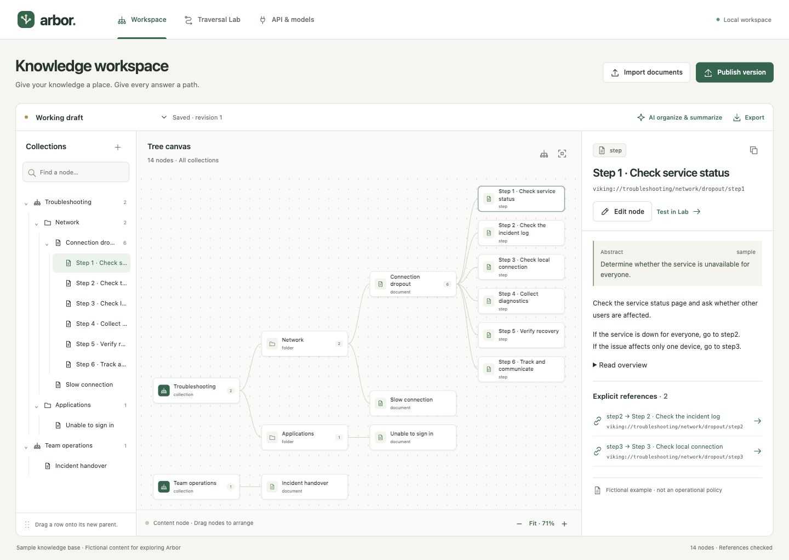
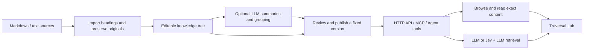
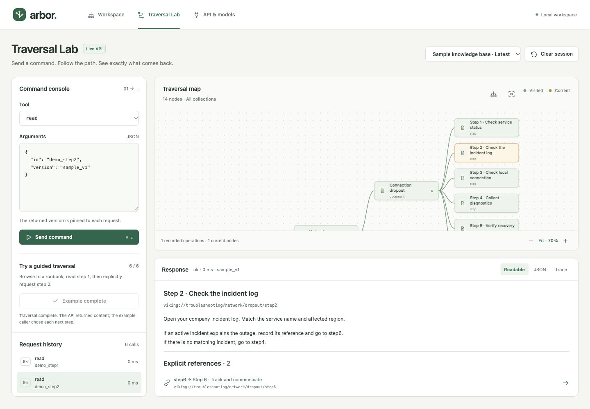

# VikingTree-AI-RAG

**English** | [繁體中文](README.zh-TW.md)

A PHP-first knowledge workspace with a separate **Traversal Lab**. Organize company documents into a browsable hierarchy, publish stable versions, and expose the same content through HTTP, MCP and agent tool schemas.

The application currently uses **Arbor** as its UI name and internal PHP namespace. The repository is named **VikingTree-AI-RAG**.



This is a working local v0.1 application, intended for the initial self-use validation. It is not a workflow execution engine: an instruction such as “If yes, go to step2” is source content. The caller interprets the condition and chooses the next API call.

## How it works

VikingTree-AI-RAG gives documents a navigable structure: **collection → category → document → section or step**. Each node can contain source content and children, plus an abstract and a longer overview. The hierarchy helps callers select an area before loading detailed evidence. Explicit references connect related steps without turning their text into executable rules.



1. **Build:** import files or create nodes manually. Source files are preserved; headings supply initial structure. LLM assistance can summarize nodes and propose document groups.
2. **Link:** explicit `step2` references within the relevant source scope resolve to stable node IDs. Missing or ambiguous targets stay unresolved and block publication.
3. **Publish:** freeze a version so later calls can keep reading the same instructions, paths and references while a separate draft changes.
4. **Discover and navigate:** external apps or agents call `list_collections`, `browse` and `read`. These operations do not need a model. Responses include exact arguments for the next read, rather than making an agent guess a path.
5. **Retrieve with AI:** when requested, the server examines candidate summaries, explores selected branches, reads bounded source evidence and can produce a cited answer. Jev is an optional scoring layer; the LLM remains required for AI features.

For example, “If yes, go to step2” remains instruction text. The caller decides whether the condition holds, then sends the returned `read_args` for step2. The server does not execute the procedure or store the caller's workflow progress.

This is a custom implementation inspired by hierarchical retrieval concepts, not an OpenViking or PageIndex wrapper. The current version does not use embeddings or a vector database and does not claim better retrieval accuracy than vector RAG. It combines deterministic browsing, lexical search and bounded model-guided tree retrieval. Hybrid search is a future direction.

## Traversal Lab



The separate Lab calls the same HTTP endpoints used by external clients. Send one command at a time, inspect readable content or raw JSON, follow exact references, and replay recorded operational events. The guided example makes six actual requests from collection discovery through reading Step 2. The map distinguishes visited nodes from the current operation; it displays hierarchy edges, not executable Yes/No rules. Screenshots show the included fictional sample data.

## Docker Compose (recommended)

```sh
cp .env.example .env
# Edit .env: set ARBOR_API_TOKEN, provider, model ID and provider credentials.
docker compose up -d --build
```

Open http://127.0.0.1:8787 and unlock with your `ARBOR_API_TOKEN`. Compose runs Apache/PHP and a separate automatic-summary worker, with persistent SQLite data in the `arbor-data` volume. The port binds to localhost by default. `.env`, local databases and Git history are excluded from the image. `docker compose down` stops the services while preserving the volume.

For a **Bedrock short-term API key**, set `ARBOR_LLM_PROVIDER=bedrock`, `ARBOR_LLM_MODEL` to your model/inference-profile ID, `AWS_REGION`, and `AWS_BEARER_TOKEN_BEDROCK`. If no Bedrock model is set, Claude Sonnet 5.5 is used: `au.anthropic.claude-sonnet-5-5` in `ap-southeast-2`/`ap-southeast-4` (requests stay in Australia), `global.anthropic.claude-sonnet-5-5` elsewhere. Two model tiers are used: `ARBOR_LLM_MODEL` builds the tree (summaries, organisation, navigation review) and `ARBOR_ROUTER_MODEL` handles query-time calls (`navigate` and AI `search`). If no router model is set, Bedrock uses Claude Haiku 5.5 (`au.anthropic.claude-haiku-5-5` in Sydney/Melbourne, `global.anthropic.claude-haiku-5-5` elsewhere); other providers reuse the build model. This uses Bearer authentication, not SigV4. For STS credentials instead, leave the bearer token empty and provide `AWS_ACCESS_KEY_ID`, `AWS_SECRET_ACCESS_KEY` and `AWS_SESSION_TOKEN`. See [AWS API key authentication](https://docs.aws.amazon.com/bedrock/latest/userguide/api-keys-use.html).

For **OpenAI**, set `ARBOR_LLM_PROVIDER=openai`, `ARBOR_LLM_MODEL` to your API model ID, and `OPENAI_API_KEY`. `OPENAI_BASE_URL` defaults to `https://api.openai.com/v1`. Use an API key, not a ChatGPT website login. Only the selected provider is called. See [OpenAI authentication](https://developers.openai.com/api/reference/overview#authentication).

Nonempty model environment values override saved UI values and are marked as environment-managed in the UI. Environment credentials are not copied into SQLite by saving settings. Replace expired Bedrock tokens in `.env`, then run `docker compose up -d --force-recreate` to reload both services. A simple container restart does not reload the env file. There is no automatic token renewal.

## UAT deployment (Drone, 10.50.10.205:9001)

`.drone.yml` follows the members-portal UATx pattern. Every build runs `tests/run.php` and `tests/http.php` on `git.vocus.com.au:4567/docker/php:8.2.35`. Promoting a build to target `uat` updates the full git repo at `/home/superu/adrian/vikingtree-uat` on 205 to the promoted commit (`git reset --keep`: live edits are kept, and the deploy stops if they conflict), copies `.env.uat` to `.env`, and recreates two containers from the existing image, with no image build: `vikingtree-uat` (`php -S` on port 9001) and `vikingtree-uat-worker` (`bin/auto.php --daemon`). SQLite data stays in the repo's git-ignored `data/` folder. Rollback to target `uat` stops the containers and keeps the repo and data.

Set `ARBOR_API_TOKEN` and `AWS_BEARER_TOKEN_BEDROCK` in `.env.uat`; the deploy stops if the access token is empty. Live updates on 205: edited PHP files and `.env` take effect on the next web request; run `docker restart vikingtree-uat-worker` so the summary worker picks them up too. The Drone repo needs the `ssh_uat_password` secret.

## Automatic summaries and layer budgets

The workspace provides **Refresh all summaries**, **Enable/Pause automatic updates**, **Build history**, and a link to layer-budget settings. The progress area shows queued changes, the current node, percentage, completion or a provider failure. Click the small **+** on a tree node to expand its abstract without leaving the tree. The inspector retains exact source content and a longer overview. The Lab also has node selection, browse/read buttons and a question form, so JSON editing is optional.

Automatic summaries are enabled by the example environment configuration. After a content, title, reference or hierarchy edit, the worker waits 15 seconds after the latest edit, then scans the hierarchy and summarizes every node bottom-up. Canvas-position changes do not trigger a build. A root is layer 1; layer 4's budget also applies to deeper nodes. Change these values in **API & models → Summary budgets by layer**:

| Layer | Maximum model output tokens per node | Abstract character cap | Overview character cap |
| --- | ---: | ---: | ---: |
| 1 | 256 | 160 | 384 |
| 2 | 512 | 320 | 768 |
| 3 | 768 | 480 | 1152 |
| 4 and deeper | 1024 | 640 | 1536 |

The token limit covers the complete JSON response (abstract and overview together); individual fields use character limits, not an exact tokenizer count. Prompts preserve step conditions, exceptions and target labels. Original content, step IDs and explicit references are never rewritten by summarization. Each node sees the full hierarchy's IDs, parent links, kinds and shortened titles, plus its source and current child summaries; this is not every document's full text in every request. Topic grouping occurs before summaries so new folders and moved nodes get the correct depth budget.

Settings saved through the UI override the environment defaults for summary automation and budgets. Enabling automatic updates schedules an initial whole-tree refresh. Automatic mode only refreshes summaries; it does not silently reorganize or publish the tree. Successful builds commit atomically. An intervening edit causes a retry against the newer draft; model failures stop until another edit or a manual refresh, avoiding repeated paid failures. Whole-structure builds support at most 600 nodes. For non-Docker use, a short-lived background worker starts on edits; run `php bin/auto.php --daemon` for continuous processing. Stopping automatic updates prevents subsequent builds; it does not cancel an in-flight provider request.

## Run locally

Requires PHP 8.2+ with PDO SQLite, cURL and mbstring. No Composer installation, Node build or frontend framework is needed.

```sh
git clone https://github.com/devbadrian-tech/VikingTree-AI-RAG.git
cd VikingTree-AI-RAG
php -S 127.0.0.1:8787 -t public public/index.php
```

- Workspace: <http://127.0.0.1:8787/>
- Traversal Lab: <http://127.0.0.1:8787/lab>
- API and model configuration: <http://127.0.0.1:8787/settings>

The first run creates `data/arbor.sqlite` and a clearly labelled fictional troubleshooting collection with six linked steps. The running demonstration uses this sample, not real company policy.

On macOS/Linux, `PHP_CLI_SERVER_WORKERS=4` before the command allows other requests while an AI search waits for its provider. AI builds run in a separate PHP CLI worker. The built-in server is for local development, not an internet deployment.

## Try the complete flow

1. In **Workspace**, import Markdown/text files or paste a document. Headings become nodes, and the original source file is preserved separately.
2. Select a node in the **Knowledge tree** to open its page: instructions, **Goes to** (links in this content), **Linked from** (backlinks), its children and the navigation summary. **Edit** opens a form with explicit **Save** (Ctrl+S) and Cancel; leaving with unsaved edits asks first. Use **+** on a tree row or **Add step** on a document to add a node; new steps are numbered “Step N · …” with slug `stepN` and placed last. **Move** changes the parent (or drag a row onto another row); ↑/↓ in the children list reorders siblings. **Delete** lists the nodes that link to what you remove. The **Map** tab shows the canvas; dragging there only changes the picture.
   - **Linking steps:** in Edit, **Insert link** picks any node and writes `[label](viking://…)` at the cursor. Inside a runbook, “go to step2” links to the sibling named “Step 2 …” or with slug `step2`. A live panel under the editor shows each link and whether it resolves before you save. Links store the target ID: renaming or moving the target rewrites the `viking://` path in the linking text, and “step N” mentions keep their target after it is renamed.
3. With a model configured, **AI organize & summarize** creates bounded abstracts and overviews, optionally groups immediate documents into folders, and reviews navigation coherence. Each summary call receives its layer budget, the budgets of every layer, its siblings' abstracts and the pathway of every node, and is told the abstract is what the cheap router reads. The review sees the whole outline and can attach a `suggested_pathway` to an issue. Original instruction text is not rewritten. Broken links and AI suggestions appear as a chip in the workspace toolbar; the review is marked stale after later edits.
4. Review and **Publish version**. Broken explicit references block publication. Publication creates an immutable snapshot; the draft remains editable.
5. In **Traversal Lab**, select a version and send real tool calls. **Run next example** performs six requests, one click at a time: root → troubleshooting → network → dropout → step1 → step2. That final branch choice belongs to the example caller.
6. Read the response, inspect its JSON, or replay recorded trace events. Clicking a returned reference performs the exact next read. Clicking a map node prepares a read command without sending it.

The map shows hierarchy edges, not executable Yes/No edges. Green nodes have been included in recorded operations; gold nodes belong to the current operation. Browse counts as visiting a node's metadata. **Fit** gives an overview; zoom and scrolling expose details. On small canvases, the map initially focuses the selected branch. The whole-tree control restores the complete overview.

## Consumer API

All five tools use `POST /api/tools/{name}` with JSON arguments. Definitions are available at `GET /api/tool-definitions`; the generated OpenAPI 3.1 description is at `GET /api/openapi.json`.

| Tool | Purpose | Model calls |
| --- | --- | --- |
| `list_collections` | Discover root menus | None |
| `browse` | List children; depth 1–4; paginated | None |
| `read` | Exact content, abstract or overview; up to 10 IDs | None |
| `search` | Keyword search, LLM routing, or Jev + LLM routing | Depends on mode |
| `navigate` | Route an issue description to only the instructions to follow | Router model, one small call per level |

### Read a specified step

```sh
curl http://127.0.0.1:8787/api/tools/read \
  -H 'Content-Type: application/json' \
  -d '{"pathway":"viking://troubleshooting/network/dropout","getNodeContent":"step1","version":"sample_v1"}'
```

The response includes the exact instruction body and references such as:

```json
{
  "label": "step2",
  "target_id": "demo_step2",
  "origin": "explicit_text",
  "status": "resolved",
  "target": {
    "title": "Step 2 · Check the incident log",
    "pathway": "viking://troubleshooting/network/dropout/step2",
    "read_args": {
      "id": "demo_step2",
      "version": "sample_v1"
    }
  }
}
```

Pass the returned `read_args` to `read`. Stable IDs survive draft moves/renames; a pinned published version preserves the exact content and paths. `latest` resolves once per call and the response returns its concrete version. Avoid `draft` for production callers: it is mutable, and its revision is exposed for inspection rather than immutable continuation.

### Browse a menu

```json
{
  "id": "demo_dropout",
  "version": "sample_v1",
  "depth": 1,
  "limit": 2
}
```

Follow `data.next_cursor` with the same node, version and depth until it is null. Each item supplies `read_args` and `browse_args`. Multi-level browse returns a flat, bounded slice with `parent_id` and `depth`; callers can reconstruct the requested subtree. The server does not attach an unbounded whole tree to every response.

### Search

```json
{
  "query": "What should I check when the connection drops?",
  "id": "demo_troubleshooting",
  "version": "sample_v1",
  "mode": "llm",
  "answer": false,
  "limit": 6
}
```

Modes: `lexical`, `llm`, `jev_llm`. Lexical search explicitly returns matches without a generated answer. In AI modes `items` lists only the nodes where routing ended, not the menus it passed through, and no answer is written unless you send `"answer": true`; the answer is one larger model call (on the sample tree about 700 input and 500 output tokens). To get only the instructions to execute for an issue, use `navigate` below. AI modes explore up to three branches per level, eight levels, 60 candidates per level and ten evidence nodes. A selected node can supply content even if it also has children. Candidates and citations are validated against the selected version and scope. Jev mode filters with the configured threshold, asks the LLM to choose among multiple viable candidates, and applies a final relevance check.

### Navigate (instructions for a calling application)

```json
{
  "query": "Customer 1234 is facing dropouts and slow speed",
  "id": "demo_troubleshooting",
  "version": "sample_v1",
  "max_instructions": 3
}
```

The router model walks the tree one level at a time. At each level it sees only the titles and abstracts of the current candidates (as short handles `c1`, `c2`, …, so invented IDs are rejected) and picks the branches that match a problem in the request. A request with several problems can pick several branches; unrelated branches are skipped. When a picked node has step children, its first step is returned without another model call. Only when the request names a step ("already did step 1", "what is step 3") does the router choose a different step. A picked node without children is returned as the instruction. Parent nodes are not returned; the pathway shows where each instruction sits:

```json
{
  "status": "ok",
  "engine": "navigate",
  "instructions": [
    {
      "id": "demo_step1",
      "pathway": "viking://troubleshooting/network/dropout/step1",
      "title": "Step 1 · Check service status",
      "kind": "step",
      "content": "Check the service status page …",
      "sequence": { "position": 1, "total": 6 },
      "next": [{ "label": "step2", "pathway": "viking://troubleshooting/network/dropout/step2", "read_args": { "id": "demo_step2", "version": "sample_v1" } }],
      "read_args": { "id": "demo_step1", "version": "sample_v1" }
    },
    {
      "id": "demo_slow",
      "pathway": "viking://troubleshooting/network/slow",
      "title": "Slow connection",
      "kind": "document",
      "content": "# Slow connection …",
      "next": [],
      "read_args": { "id": "demo_slow", "version": "sample_v1" }
    }
  ],
  "coverage": "selected_branches"
}
```

The caller evaluates the conditions in `content` and follows `next[].read_args` with `read`; no further model call is needed. `no_match` means no branch matched, and `instructions` is empty. `meta.usage` reports the router calls and provider-reported tokens for the request. Limits: eight levels, 60 candidates per call, five picks per level, `max_instructions` 1–5 (default 3). Routing quality depends on abstracts that say which problems belong in each branch, which is what the build step is asked to write.

**Tokens and thinking.** Claude 5+ models think adaptively, and thinking is billed as output. Arbor keeps thinking on and sends `output_config.effort`: `low` for routing (`ARBOR_ROUTER_EFFORT`) and the model default for building (`ARBOR_BUILD_EFFORT`). Every call also gets thinking headroom on top of its answer budget (2,048 tokens for routing, 4,096 for building), so reasoning cannot crowd out the JSON; only generated tokens are billed. Measured on Bedrock with Haiku 5.5 (Oct 2026), a 10-request routing benchmark on the sample tree scored 10/10 at both low and default effort; low averaged about 30 output tokens per call and default about 80. `"Customer 1234 is facing dropouts and slow speed"` costs 3 calls, about 1,100 input and 51 output tokens. `thinking: disabled` is not used because Sonnet 5.5 rejects it.

`data.coverage` reports `entire_scope`, `selected_branches` or `budget_limited`. `no_answer` means no supported answer in the explored evidence, not proof that the entire company corpus lacks an answer. `budget_exhausted` is distinct from `no_answer`. Provider/configuration errors use non-2xx responses with `error.code` and never masquerade as a knowledge miss. Trace messages describe operations, not hidden model reasoning.

### Authentication

Copy `.env.example` to `.env` and set `ARBOR_API_TOKEN` to require a shared access token. External clients send `Authorization: Bearer YOUR_TOKEN`; the browser shows an unlock form. Without a configured token, the app accepts only loopback requests with a localhost host name. Browser writes require CSRF protection and cross-origin requests are rejected.

This is a single-workspace trust model. The shared token grants administrative access as well as consumer access. It is not a tenant/user/role permission system. Do not expose the local server as a business service; add a production HTTP server, TLS, scoped credentials, ACLs and operational controls first.

## MCP and agent tools

Stateless HTTP MCP endpoint: `http://127.0.0.1:8787/mcp`. Supported protocol: `2025-11-25`, JSON-RPC POST responses, `initialize`, `ping`, `tools/list`, `tools/call`, `resources/list`, and `resources/read`. Notifications return 202. GET/SSE, resumable streaming, subscriptions and OAuth discovery are not implemented.

Stdio configuration:

```json
{
  "mcpServers": {
    "arbor": {
      "command": "php",
      "args": ["/absolute/path/to/VikingTree-AI-RAG/bin/mcp.php"]
    }
  }
}
```

Stdio uses filesystem access to the same database; it does not require the HTTP token. Tool responses include both `structuredContent` and a JSON text fallback. HTTP and stdio share the same tool implementation. An agent integration can use the JSON schemas from `/api/tool-definitions` or the OpenAPI document directly.

## Model connections

Configure **API & models**. No credentials or cloud calls are preconfigured.

- **OpenAI-compatible**: base URL ending in `/v1`, API key, model ID; Chat Completions with `max_completion_tokens` and JSON requested in the prompt. Providers with different parameter contracts need an adapter adjustment.
- **Anthropic**: `https://api.anthropic.com/v1`, API key, model ID; Messages API.
- **AWS Bedrock**: model/inference-profile ID, region and access/secret/session credentials. AWS environment credentials are supported. Bearer tokens or native SigV4 signing call Converse. IAM roles/automatic credential refreshing and the full AWS SDK credential chain are not implemented.
- **Jev (optional)**: TypeSafe System One Noul scores through `jev-latest`. LLM remains required for AI features.

Model keys stay in the local SQLite database outside `public/` and are redacted in settings responses and exports. They are not encrypted at rest beyond operating-system file permissions. Selected source content is sent to the configured provider when an AI operation is requested. The connection test makes a small actual LLM request.

The adapters and retrieval logic have automated fixture coverage; real provider quality, model compatibility, cost and latency still require testing with your credentials. Bedrock signing has not been verified against a live AWS account.

## Import and build boundaries

- Markdown / UTF-8 text only, 30 files per import, 500 KB/file, 2 MB total. Individual node text fields are capped at 100 KB; add headings to split larger sections.
- Imported sources are hash-deduplicated. Changed files currently create new documents; there is no source synchronization or merge/update wizard yet.
- Explicit links are sibling `stepN` mentions (document introductions can reference child steps) and Markdown links to exact `viking://` paths. No inferred step targets are invented. Ambiguous or missing targets remain unresolved. Resolved IDs are retained on target rename or move.
- Abstracts and overviews follow the layer budgets above; the total model response has a token limit and each field has a character cap. Raw content remains stored separately.
- AI grouping operates on documents directly under the selected menu and preserves document IDs and internal headings. Scoped builds process the selected nodes; grouping refreshes the whole resulting tree, and automatic updates always refresh the whole tree.
- Navigation review uses batches of abstracts, paths and references. It flags suggestions for human review; it does not prove SOP correctness, completeness or cross-document consistency.
- An AI job commits atomically only if the draft revision is unchanged. It can build up to 600 nodes per job. Jobs are stored in SQLite; local CLI workers start automatically when process execution is available. If execution is disabled, run `php bin/worker.php JOB_ID` with the same database environment. The UI exposes recent job history; automatic revision-conflict retries are supported. General job cancellation and recovery for interrupted manual jobs remain future work.
- JSON export contains the selected snapshot and provenance references. It is an interchange view, not a full backup/import format. For a full backup use SQLite's backup facility to include sources, versions and settings; protect the backup because it contains model credentials.

## Verification

```sh
php tests/run.php
php tests/http.php
```

The first suite uses a disposable SQLite database and deterministic model doubles. The second starts temporary loopback servers and verifies HTTP authentication/CSRF, real routes, MCP HTTP and local provider fixtures. Neither suite touches the working database or sends data to a live model. Browser checks covered import, edit/save, publish, version selection, exact reference navigation, six-call traversal, recorded replay and responsive layouts at 1440, 586 and 390 pixels.

## Architecture and next steps

`public/index.php` is the HTTP boundary; `src/Repository.php` owns versioned nodes and transactional edits; `Tools.php` is shared by HTTP, MCP and the Lab; `Models.php` isolates provider protocols; `Importer.php` preserves sources and builds derived navigation; `views/app.php` and `public/assets/` are the PHP/HTML/vanilla-JavaScript UI.

SQLite stores one draft document and immutable JSON snapshots. This deliberately keeps the first implementation compact. Before scaling beyond the initial corpus, normalize nodes/edges, add FTS/hybrid retrieval and incremental source updates, virtualize the canvas, and add scoped authorization. Retrieval quality should be measured against labelled company questions before selecting LLM-only, Jev-assisted or hybrid routing. OpenViking and PageIndex compatibility is not claimed; their navigation concepts informed this custom format.
