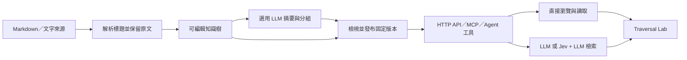

# VikingTree-AI-RAG

[English](README.md) | **繁體中文**

以 PHP 為核心的企業知識樹工作台，將文件、SOP 及操作說明整理成可瀏覽的階層，透過 HTTP API、MCP 和 Agent 工具提供一致的存取方式。另設 **Traversal Lab**，讓你逐次發送命令，觀察實際回應及樹上的到訪位置。

介面名稱及內部 PHP namespace 目前保留 **Arbor**；GitHub 專案名稱為 **VikingTree-AI-RAG**。


目前為可運行的本機 v0.1，適合初期自用驗證，並非已完成企業部署的服務。內置示範內容屬虛構資料，不是實際操作政策。

## 運作方式

基本結構為 **知識庫 → 分類 → 文件 → 章節／步驟**。節點可同時有內容和子節點，並附有短摘要與較長概覽。呼叫方先選擇相關範圍，再取得需要的原文。



1. **建立：** 匯入 Markdown／文字或手動新增節點。標題形成初始階層，原始來源另行保存；LLM 可協助產生摘要及文件分組。
2. **建立引用：** 在對應文件範圍內解析 `step2` 等明確引用，連接至穩定節點 ID。找不到或有歧義的目標不會被憑空補上，未解決的引用會阻止發布。
3. **發布：** 建立不可變更的版本。草稿可繼續修改，但指定舊版本的呼叫仍取得當時的內容及引用。
4. **瀏覽：** 外部系統透過 `list_collections`、`browse`、`read` 探索分類和取得原文，不需要呼叫模型。回應附有下次可直接使用的參數。
5. **智能檢索：** 按要求使用 LLM 檢視候選摘要、選擇分支、讀取有限範圍的來源，並可產生附引用的答案。Jev 是可選評分層；AI 功能仍需要 LLM。

「If yes, go to step2」是原文內容。呼叫方自行判斷 Yes／No，再傳送 step2 的 `read_args`。系統不執行 SOP、不代替呼叫方決定流程條件，也不保存呼叫方的流程進度。

本專案參考階層檢索概念，自訂資料格式，並非 OpenViking 或 PageIndex 的包裝或兼容實作。目前沒有使用 embedding 或向量資料庫，也未證明準確率優於向量 RAG；現有方式是直接瀏覽、關鍵字搜尋及有範圍限制的模型導覽。混合搜尋屬未來方向。

## Docker Compose 與環境設定

```sh
cp .env.example .env
# 編輯 .env，設定 ARBOR_API_TOKEN、模型 ID 及供應商憑證。
docker compose up -d --build
```

開啟 http://127.0.0.1:8787 並以 `ARBOR_API_TOKEN` 解鎖。Compose 提供 Apache／PHP 網頁服務及獨立自動摘要 worker；SQLite 保存於 `arbor-data` volume。預設只綁定本機，`.env`、本機資料庫及 Git 歷史不會加入映像檔。`docker compose down` 會停止服務但保留資料。

- **Bedrock 短期 API key：** 設定 `ARBOR_LLM_PROVIDER=bedrock`、`ARBOR_LLM_MODEL`、`AWS_REGION` 及 `AWS_BEARER_TOKEN_BEDROCK`，使用 Bearer 驗證。若使用 STS，留空 bearer token，另填 `AWS_ACCESS_KEY_ID`、`AWS_SECRET_ACCESS_KEY`、`AWS_SESSION_TOKEN` 三項。
- **OpenAI API：** 設定 `ARBOR_LLM_PROVIDER=openai`、`ARBOR_LLM_MODEL` 及 `OPENAI_API_KEY`。`OPENAI_BASE_URL` 預設為 `https://api.openai.com/v1`。使用 API key，不是 ChatGPT 網站登入資料；只會呼叫所選供應商。
- 非空的模型環境設定優先於 UI 保存值，介面會標示由環境管理；儲存設定不會將環境憑證複製到資料庫。
- 短期 token 過期後，更新 `.env` 並執行 `docker compose up -d --force-recreate`。單純 restart 不會重讀 env 檔；目前不會自動續期。[AWS 驗證說明](https://docs.aws.amazon.com/bedrock/latest/userguide/api-keys-use.html)

## 自動摘要與節點顯示

工作台提供 **Refresh all summaries**、**Enable／Pause automatic updates**、**Build history** 和層級預算設定入口。狀態區顯示等待、目前處理節點、百分比、完成或錯誤。點擊樹上節點的小 **+** 可展開摘要；原文及較長概覽仍在右側面板。Lab 新增節點選擇、瀏覽／讀取按鈕與搜尋表單，毋須手寫 JSON。

`.env.example` 預設啟用自動摘要。修改內容、標題、引用或階層後，等待最後一次編輯結束 15 秒，再從最底層向上更新全樹摘要；單純移動畫布位置不觸發。根節點為第 1 層，第 4 層預算亦用於更深層。可在 **API & models → Summary budgets by layer** 修改：

| 層級 | 每節點模型輸出 token 上限 | 短摘要字元上限 | 概覽字元上限 |
| --- | ---: | ---: | ---: |
| 1 | 256 | 160 | 384 |
| 2 | 512 | 320 | 768 |
| 3 | 768 | 480 | 1152 |
| 4 及以下 | 1024 | 640 | 1536 |

Token 上限涵蓋整份 JSON 回應（短摘要與概覽合計）；個別欄位採字元上限，不是精確 token 計算。提示保留步驟條件、例外及跳轉目標；原文、步驟 ID 與明確引用不會被摘要改寫。每個節點會取得全樹的 ID、父節點、類型及縮短標題，以及本身原文與子節點最新摘要，不是每次傳送所有文件全文。分組先完成，才依最終位置產生摘要。

UI 保存的自動摘要與預算設定優先於環境預設值。啟用時會安排一次全樹更新；自動模式不會擅自重組或發布。結果以交易完整提交，期間有編輯便改用新版草稿重試；模型失敗後停止，等待新編輯或手動刷新。全樹最多 600 個節點。非 Docker 模式會在編輯後啟動短期背景 worker；可執行 `php bin/auto.php --daemon` 持續處理。暫停不會取消已發出的模型請求。

## 快速啟動

需要 **PHP 8.2+**，以及 PDO SQLite、cURL、mbstring 擴充。無需安裝 Composer 套件、Node 建置工具或前端框架。

```sh
git clone https://github.com/devbadrian-tech/VikingTree-AI-RAG.git
cd VikingTree-AI-RAG
php -S 127.0.0.1:8787 -t public public/index.php
```

| 介面 | 網址 |
| --- | --- |
| 知識樹工作台 | http://127.0.0.1:8787/ |
| Traversal Lab | http://127.0.0.1:8787/lab |
| API 與模型設定 | http://127.0.0.1:8787/settings |

首次啟動會建立 `data/arbor.sqlite` 及包含六個步驟的故障排除範例。macOS／Linux 可在啟動指令前加上 `PHP_CLI_SERVER_WORKERS=4`，避免模型等待期間阻塞其他請求。AI 建樹會使用獨立 PHP CLI worker。PHP 內置伺服器只供本機開發使用。

## 建立及測試知識樹

1. 在 **Workspace** 匯入 Markdown／文字檔，或貼上文件。標題會成為節點，來源原文會保留。
2. 在左側 **Knowledge tree** 選取節點，開啟節點頁面：指示內容、**Goes to**（此內容的連結）、**Linked from**（哪些節點連到這裡）、子節點及導航摘要。按 **Edit** 進入編輯表單，以 **Save**（Ctrl+S）或 Cancel 明確儲存；有未儲存的修改時離開會先詢問。用樹狀列上的 **+** 或文件頁的 **Add step** 新增節點；新步驟自動命名為「Step N · …」（slug `stepN`）並排在最後。**Move** 改變父節點（亦可把一列拖到另一列上）；子節點清單的 ↑/↓ 調整順序。**Delete** 會列出連到被刪除節點的其他節點。**Map** 分頁顯示畫布，拖動只改變畫面位置。
   - **連結步驟：** 編輯時按 **Insert link** 選擇任何節點，會在游標位置寫入 `[label](viking://…)`。在同一份 runbook 內也可寫「go to step2」，連到名為「Step 2 …」或 slug 為 `step2` 的同層步驟。編輯框下方會即時顯示每個連結是否解析成功。連結以目標 ID 儲存：目標改名或移動時，連結文字中的 `viking://` 路徑會自動更新；「step N」引用在目標改名後仍指向原步驟。
3. 設定模型後使用 **AI organize & summarize** 產生摘要、概覽及分類建議，原始指令文字不會被改寫。頁尾可查看最近的導航檢視結果；後續編輯會將其標示為過時。
4. 檢視後按 **Publish version** 建立固定版本。未解決的明確引用會阻止發布。
5. 到 **Traversal Lab** 選擇版本，逐次按 **Run next example**：發現知識庫 → Troubleshooting → Network → Dropout → Step 1 → Step 2。最後的分支由示範呼叫方選擇。
6. 查看可讀回應、JSON 或 Trace；點擊回傳引用直接讀取目標，點擊地圖節點則準備命令而不立即發送。


Lab 使用實際 HTTP API。綠色代表操作紀錄中到訪過的節點，金色代表目前操作涉及的節點；瀏覽節點摘要亦計為到訪。地圖連線表示階層，不表示可執行的 Yes／No 規則。可縮放、聚焦子樹及回放操作事件，Trace 不包含模型隱藏推理。

## HTTP API

四項工具均使用 `POST /api/tools/{name}`，傳入 JSON。`GET /api/tool-definitions` 提供工具 schemas，`GET /api/openapi.json` 提供 OpenAPI 3.1 文件。

| 工具 | 用途 | 模型需求 |
| --- | --- | --- |
| `list_collections` | 發現頂層知識庫及入口 | 無 |
| `browse` | 列出子節點，支援深度 1–4 及分頁 | 無 |
| `read` | 讀取原文、摘要或概覽，一次最多 10 個 ID | 無 |
| `search` | 關鍵字、LLM 或 Jev + LLM 檢索 | 視模式而定 |
| `navigate` | 把問題描述導向只需執行的指示節點 | 查詢模型，每層一次小型呼叫 |

### 讀取特定步驟

```sh
curl http://127.0.0.1:8787/api/tools/read \
  -H 'Content-Type: application/json' \
  -d '{"pathway":"viking://troubleshooting/network/dropout","getNodeContent":"step1","version":"sample_v1"}'
```

回應包含原文及明確引用，例如以下引用片段：

```json
{
  "label": "step2",
  "target_id": "demo_step2",
  "origin": "explicit_text",
  "status": "resolved",
  "target": {
    "title": "Step 2 · Check the incident log",
    "pathway": "viking://troubleshooting/network/dropout/step2",
    "read_args": {"id": "demo_step2", "version": "sample_v1"}
  }
}
```

將 `read_args` 原樣傳回 `read`，便可精確取得下一步。ID 不受草稿改名或移動影響；固定發布版本亦保存當時的路徑與內容。`latest` 每次呼叫解析一次，回應會提供實際版本，後續請求應固定使用該版本。`draft` 可變動，不適合作為正式流程的固定版本。

### 瀏覽分類

```json
{"id":"demo_dropout","version":"sample_v1","depth":1,"limit":2}
```

使用同一節點、版本及深度跟隨 `data.next_cursor`，直至其為 null。每項目附有 `read_args` 和 `browse_args`。多層瀏覽以有上限的平面列表回傳，包含 `parent_id` 和 `depth`，可重建該次取得的子樹；不會每次附送整棵樹。

### 搜尋及答案

```json
{
  "query":"What should I check when the connection drops?",
  "id":"demo_troubleshooting",
  "version":"sample_v1",
  "mode":"llm",
  "answer":true,
  "limit":6
}
```

模式包括 `lexical`、`llm`、`jev_llm`。關鍵字模式只返回命中，不生成答案。AI 模式的 `items` 只列出路由最後停下的節點，不含途經的目錄；除非傳入 `"answer": true`，否則不會生成答案（答案是一次較大的模型呼叫，在範例樹上約 700 輸入、500 輸出 token）。若只要針對問題取得要執行的指示，請用下方的 `navigate`。AI 模式最多探索每層三個分支、八層、每層 60 個候選及十個證據節點；引用及候選 ID 會按範圍與版本驗證。Jev 模式按設定門檻篩選候選，多個可行候選交由 LLM 選擇，最後再檢查相關性。

### Navigate（給呼叫端應用程式的指示）

```json
{
  "query": "Customer 1234 is facing dropouts and slow speed",
  "id": "demo_troubleshooting",
  "version": "sample_v1",
  "max_instructions": 3
}
```

查詢模型（Bedrock 預設 Claude Haiku 5.5）逐層走訪樹狀結構。每層只看目前候選的標題與摘要（以 `c1`、`c2` 等短代號提供，捏造的 ID 會被拒絕），挑選與請求中問題相符的分支；一個請求含多個問題時可同時選多個分支，無關分支會略過。選中的節點若有步驟子節點，直接回傳第一步，不需再呼叫模型；只有請求明確提到步驟（例如「已做完 step 1」）時，才由模型選擇其他步驟。沒有子節點的節點本身就是指示。父節點不會回傳，`pathway`（例如 `viking://troubleshooting/network/dropout/step1`）已顯示位置。每個指示包含原文 `content`、`sequence`（步驟位置）、`next[].read_args`（下一步）及 `read_args`。查無相符分支時 `status` 為 `no_match`，`instructions` 為空。`meta.usage` 列出該次查詢的模型呼叫數及供應商回報的 token 數。

**Token 與 thinking：** Claude 5+ 模型會自適應地思考，思考內容以輸出 token 計費。Arbor 保留 thinking，並以 `output_config.effort` 控制：路由用 `low`（`ARBOR_ROUTER_EFFORT`），建樹用模型預設（`ARBOR_BUILD_EFFORT`）。每次呼叫在答案預算之外另留思考空間（路由 2,048、建樹 4,096 token），避免思考擠掉 JSON；只按實際產生的 token 計費。2026 年 10 月以 Bedrock Haiku 5.5 在範例樹上測 10 個請求，low 與預設皆 10/10 正確；low 平均每次約 30 輸出 token，預設約 80。不使用 `thinking: disabled`，因為 Sonnet 5.5 會回 HTTP 400。

`data.coverage` 表示 `entire_scope`、`selected_branches` 或 `budget_limited`。`no_answer` 只代表已探索證據不足，不代表全公司資料皆無答案；`budget_exhausted` 另行表示已達限制。模型或設定錯誤使用非 2xx 回應及 `error.code`，不會假裝成查無資料。

## MCP 與 Agent

HTTP MCP：`http://127.0.0.1:8787/mcp`。支援協定 `2025-11-25`，以無狀態 JSON-RPC POST 提供 `initialize`、`ping`、`tools/list`、`tools/call`、`resources/list` 及 `resources/read`。通知回傳 202；尚未實作 GET／SSE、串流續接、訂閱或 OAuth discovery。

stdio 設定：

```json
{
  "mcpServers": {
    "arbor": {
      "command": "php",
      "args": ["/absolute/path/to/VikingTree-AI-RAG/bin/mcp.php"]
    }
  }
}
```

stdio 以檔案系統權限存取同一資料庫，不要求 HTTP token。工具同時回傳 `structuredContent` 與 JSON 文字；HTTP、MCP 和 Lab 共用核心實作。Agent 亦可直接使用工具 schema 或 OpenAPI 文件。

## 模型設定

在 **API & models** 設定，預設沒有憑證或外部模型呼叫。

- **OpenAI-compatible：** `/v1` base URL、API key、model ID。使用 Chat Completions 和 `max_completion_tokens`；不同參數規格的供應商可能需要調整 adapter。
- **Anthropic：** Messages API、API key、model ID。
- **AWS Bedrock：** Converse API、模型／inference profile ID、區域及 access／secret／session credentials；支援 AWS 環境變數，使用 SigV4 簽署。未實作完整 AWS SDK credential chain 或自動角色憑證更新。
- **Jev（可選）：** TypeSafe System One Noul，使用 `jev-latest` 評分。AI 功能仍需要 LLM。

模型憑證儲存在 `public/` 以外的本機 SQLite，設定回應及匯出會隱藏憑證；除了作業系統檔案權限，沒有額外靜態加密。執行 AI 功能時，選取的內容會傳送給設定的供應商；連線測試會發出小型真實請求。

已以本機 fixture 驗證 adapter 與檢索流程；真實模型品質、兼容性、費用及延遲仍需自行實測。Bedrock 尚未用真實 AWS 帳戶驗證。

## 存取及部署

將 `.env.example` 複製為 `.env` 並設定 `ARBOR_API_TOKEN`，便可要求共用 token。外部呼叫使用 `Authorization: Bearer YOUR_TOKEN`；瀏覽器會顯示解鎖表單。未設定 token 時只接受本機 loopback 及 localhost hostname。瀏覽器寫入有 CSRF 保護，跨來源請求會被拒絕。

目前只有單一工作區的信任模型，共用 token 同時可存取管理及查詢功能，未提供租戶、角色或節點權限。正式企業部署仍需正式 HTTP server、TLS、權限區分及營運控制。資料庫、憑證和使用者匯入內容不包含在 repository 內。

## 匯入與建樹限制

- 只支援 Markdown／UTF-8 文字；每批最多 30 個檔案、每檔 500 KB、合計 2 MB。節點文字欄位上限 100 KB，較大內容需用標題分段。
- 原始來源以 hash 去重；修改後的檔案目前建立新文件，沒有來源同步或合併精靈。
- 明確引用支援同範圍的 `stepN` 文字及 Markdown 中的完整 `viking://` 路徑。已解析 ID 在目標改名或移動後仍保留。
- AI 摘要依上述層級預算設定模型總輸出 token 上限及個別欄位字元上限。
- 分組針對所選目錄直接包含的文件，保留文件 ID 及內部標題。範圍建樹處理選定節點；分組後及自動更新會刷新全樹摘要。
- 導航檢視按批次檢查摘要、路徑與引用，提供人工檢視建議，不保證 SOP 正確、完整或跨文件一致。
- 每項建樹工作最多 600 個節點，只有草稿 revision 沒變時才會原子提交。工作保存在 SQLite，由本機 CLI worker 執行；若禁止啟動程序，可用相同資料庫設定執行 `php bin/worker.php JOB_ID`。已提供最近工作紀錄及自動摘要版本衝突重試；一般取消及中斷手動工作的復原仍待開發。
- JSON 匯出包含選定版本及來源參照，不是完整備份／還原格式。完整備份應使用 SQLite backup 功能，並妥善保護其中的憑證。

## 驗證

```sh
php tests/run.php
php tests/http.php
```

測試使用獨立暫存資料庫及本機模型 fixture，不修改工作資料庫，也不呼叫真實模型。HTTP 測試涵蓋認證、CSRF、路由、MCP 及模型協定。介面曾驗證匯入、編輯、發布、版本選擇、引用跳轉、六步導覽、事件回放及桌面／手機版面。

## 架構及後續方向

| 位置 | 職責 |
| --- | --- |
| `public/index.php` | HTTP 入口 |
| `src/Repository.php` | 節點、版本與交易式編輯 |
| `src/Tools.php` | HTTP、MCP、Lab 共用工具 |
| `src/Models.php` | 模型供應商 adapter |
| `src/Importer.php` | 來源保存與衍生導航 |
| `src/Mcp.php`、`bin/mcp.php` | MCP 協定與 stdio 入口 |
| `views/app.php`、`public/assets/` | PHP／HTML／原生 JavaScript 介面 |

初版以 SQLite 保存草稿及不可變 JSON 版本。擴大規模前，應考慮正規化節點／連線、全文與混合搜尋、增量來源更新、畫布虛擬化、權限管理，以及用真實公司問題建立檢索評估集。請參閱 [英文 README](README.md) 及 [設計文件](DESIGN.md)。
